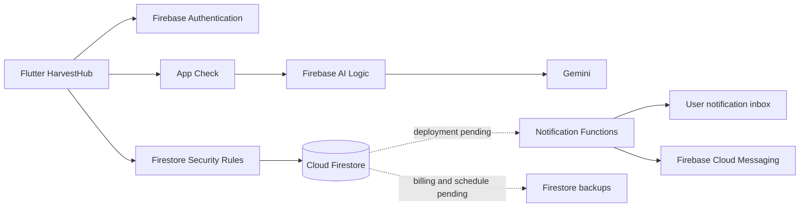

# HarvestHub — SRS implementation audit

Source: `HarvestHub_Multi-Platform App Computing_SRS.pdf`, all 22 pages.
Audit date: 26 September 2026. Android release: 1.0.1 (build 2).

## Conclusion

**The project is not yet fully production complete.** Core marketplace flows use Firebase Auth and Firestore, and the changes below close several frontend and backend gaps. Production push delivery, scheduled backups, and Android Gemini attestation remain pending. Tests and source inspection do not establish that every production interaction works on every platform.

No sample catalog, user, market, order, rating or review documents were inserted into production during this audit. Test fixtures remain in test/preview code; the production bootstrap constructs FirebaseStore.

## Requirements and evidence

“Implemented” means the relevant code path exists, not that a production device test has been performed for every combination.

| SRS pages | Requirement | Implementation / evidence | Status and limits |
|---|---|---|---|
| 4–5, 9, 11 | Flutter and Firebase accounts | `main.dart`, `auth.dart`, `firebase_store.dart`, registration rules | Implemented; Auth sign-in, signup, password reset, profile editing, logout. Public signup forbids admin. |
| 9 | Role selection landing | Unified sign-in resolves the Firestore role; signup offers customer/farmer | Intentional user override of the pictured role selection, recorded below. |
| 11 | Profile/contact/address/password | `profile.dart`, `avatars.dart`, Firebase profile mutation | Implemented. Avatar rules were missing in production; merged rules are now deployed. Images are compressed and stored as bounded data URIs in Firestore, not an unconfigured Storage bucket. |
| 12 | Catalog/categories and product details | `customer.dart`, `operations.dart`, category counters | Implemented with live data. Removed fabricated reviews, distance and organic claims. Missing descriptions now say they are missing. |
| 13 | Search by name/category/farmer/market/location | `ExploreScreen` | Implemented over loaded catalog; “Load more” is available for paginated data. It is not a full database search index. |
| 13 | Distance filter | Farmer map coordinates, customer location picker, geodesic distance via Geolocator | Added 5/10/25/50 km filters. Farms without coordinates are excluded when distance is selected. No invented distance. |
| 14 | Wishlist | Private preferences with own-user rules | Implemented. Persistence failures are now surfaced instead of silently swallowed. |
| 14 | Cart and subtotal | Store quantities, stock validation, BasketScreen | Implemented. Floating home cart is now 82 logical pixels, about 38 px larger; physical centimetres vary by phone. |
| 14 | Simulated checkout/address/confirmation | Firestore transaction validates catalog prices, stock and order snapshots | Implemented with idempotent request receipts. **Current free-plan transaction limits checkout to three distinct products; orders are split per product.** This is a functional limitation against an unrestricted cart requirement. No real payment provider is required by the SRS. |
| 15 | Order history/status | `orders.dart`, role-scoped queries | Implemented. Preserves actual order IDs and distinguishes Confirmed from Ready for pickup. Long IDs are truncated only visually on cards, with full IDs in details. |
| 15 | AI assistant | `gemini_assistant.dart`, `assistant.dart` | Replaced canned answers with Gemini streaming through Firebase AI Logic. Real catalog context, retry, timeout and stale-stream cancellation. Supplied key passed Google model-list and generation tests. **End-to-end app attestation remains unverified/pending approval.** |
| 15 | Follow farms | Private followed IDs and farm screens | Implemented. Restock notification server trigger added; production delivery remains pending. |
| 6, 16 | Book/modify/cancel available pickup slots | Farmer editor publishes windows; checkout intersects farm windows; order details modify/cancel | Replaced hardcoded windows. Rules reject unpublished windows and closed/missing orders. Farmer/admin can read booking for their order. Windows are textual schedules, not dated capacity reservations. |
| 6, 16 | Farmer catalog and stock management | `operations.dart`, SparkBackend, rules | Implemented product CRUD/archive and inventory. Removed Organic/Featured switches that did not persist anything. |
| 6, 16 | Farmer order status updates | Sequential lifecycle and stock-restoring cancellation | Implemented; emulator and domain tests cover permissions and transitions. |
| 16 | Farmer daily/weekly/monthly reports | `LiveReports`, SparkBackend report aggregation | Implemented from actual orders. No fabricated chart values. |
| 16 | New-order/status/pickup/restock/low-stock notifications | `notifications.dart`, `functions/notifications.js` | Client opt-in, token registration/revocation, inbox and server triggers added. **Functions not deployed: project remains Spark with no billing.** APNs/iOS notification configuration is also absent. |
| 6 | Admin users/farmers/categories/products/orders | `operations.dart`, `reporting.dart`, rules | Implemented core management. Admin self-suspension denied; admin account role cannot be self-assigned through signup or profile editing. |
| 6, 17 | Admin public content, About, Contact | `market_directory.dart`, `profile.dart` | Added content editor for About/support contacts, public content display, and About menu route. Feedback form already writes protected Firestore records for admin review. |
| 20–21 | Farmers-market records/GPS/hours/active | Market directory/editor and `farmersMarkets` rules | Added live admin CRUD-style editing and active/inactive publishing; customer directory. No fake markets seeded. |
| 19 | Authentication, authorization, data transport | Firebase Auth/TLS, restrictive Firestore rules, emulator deny tests | Implemented core controls. This is not a full penetration test or an availability guarantee. |
| 19 | Accessibility/responsiveness | Semantics, text scaling tests, light/dark palettes | Existing layout tests cover 360/393/430 px phones and selected 1.6× text scale. No certification claim. |
| 19 | Reliability/scalability/24×7 | Firebase-hosted database; pagination and errors | Platform provides managed hosting; a load test, uptime monitoring and operational SLA have not been established. |
| 19 | Scheduled automatic backups, including logs | Entire Firestore database would include admin activity logs | **No schedules exist.** Needs billing approval/enablement, then a daily schedule and restore drill. Do not confuse local source backups with database backups. |
| 22 | Source/APK/install instructions/database structure | Repository, APK output, companion release notes | Android APK built and installed as an in-place update on Infinix X690B. iOS IPA, submission ZIP, ReadMe.doc, final report packaging and mandatory MP4 demo are not complete deliverables in this audit. |

## SRS conflicts and user overrides

- Page 7 excludes push notifications and delivery/pickup, while pages 6 and 16 explicitly require pickup and push. This audit follows the detailed functionality where possible and calls out infrastructure that is not activated.
- Page 9 describes role cards before login. The user explicitly requested one shared login, automatic role detection, and only Customer/Farmer choices during signup. That request takes precedence.
- Checkout is simulated by specification. No real payment processing, logistics or settlement is represented as implemented.
- “Fully working” cannot be inferred from screenshots or a passing build. Device, network, role and production-service checks are separate evidence.

## Changes made in this audit

1. Enabled Firebase AI Logic for the existing Android app and restricted requests to authenticated Firebase users. The app uses managed Gemini authorization; the supplied private API key is **not embedded, persisted, or used by the APK**. Direct validation confirmed that key works.
2. Added Ola, an original animated vector robot on the customer dashboard’s left side, with an accessible chat action and greeting. Enlarged only the floating cart control.
3. Streamed chatbot answers from Gemini 3.5 Flash-Lite; removed fabricated canned responses and fixed dark-mode background, connection retry and conversation-reset behavior.
4. Added farmer pickup availability/coordinates, distance search, market management, and public content editing.
5. Reconciled deployed rules with local rules, preserving remote checkout/device/market additions and adding avatar, pickup and admin self-suspension fixes. The pre-audit deployed rules are retained in `deployed-rules-before-audit.rules` for review.
6. Added notification client/server implementation. Firebase Functions deployment remains blocked by plan/billing, not presented as active.
7. Removed fabricated ratings/distances/certification claims and nonpersisting product switches.

## Verification recorded

- `flutter analyze --no-pub`: no issues found after final packaging.
- Existing Flutter regression suite: 30 passed, one optional screenshot test skipped.
- Additional streamed-chat regression: passed (chunks, failure retry, cancellation/reset).
- Firestore emulator: 7 tests passed, including registration/RBAC, avatar update, admin suspension protection, stock/price integrity, lifecycle, feedback privacy, three-product transaction, pickup availability, market permissions and forged-notification denial.
- Backend domain tests: 3 passed.
- Gemini direct model listing: HTTP 200; real generation: HTTP 200 with expected test reply. This verifies the supplied key/model, **not** phone App Check.
- Initial deployment job reported success but remote readback was stale. A direct Firebase CLI deployment then compiled, uploaded and released the rules and indexes successfully; final readback checked separately.
- Production backup schedule listing: empty.
- Production Functions listing: no deployed functions.
- ADB installation succeeded on Infinix X690B at 11:06:25 local time, preserving data. Package reports version 1.0.1 / code 2. The phone became unavailable before a full app launch/Gemini smoke test.

## Pending decisions / external prerequisites

1. **Phone verification:** Update installation succeeded with `adb install -r`. Reconnect for an end-to-end signed-in Gemini/device smoke test.
2. **App Check:** automatic approval review rejected allowing unrecognized/sideloaded app versions and removing Play-license requirements. No policy workaround was applied. Explicit approval is pending. Existing app attestation settings remain unchanged; Android app-to-Gemini must be tested after configuration or through a Play-distributed build.
3. **Billing:** project is still Spark. No Blaze upgrade or paid-service activation was performed. After user enablement, deploy the notification codebase and configure a daily Firestore backup schedule (proposed retention: 7 days), then verify delivery and recovery.
4. **Other platforms:** Apple signing/APNs and production web App Check require their own setup; Android-only verification cannot certify iOS/web.
5. **Remaining product limits:** three-product transactional checkout cap, loaded-catalog search scope, textual pickup windows, and operational testing need resolution before claiming full SRS compliance.

## Data flow

## References for infrastructure decisions

- [Firebase AI Logic setup](https://firebase.google.com/docs/ai-logic/get-started?platform=flutter)
- [Supported Gemini models](https://firebase.google.com/docs/ai-logic/models)
- [Managed Gemini authorization](https://firebase.google.com/docs/ai-logic/faq-and-troubleshooting)

The PDF was treated as requirements data. Its assignment/process instructions do not override the user's requested application behavior.
